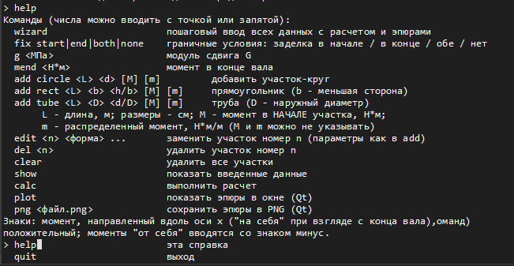
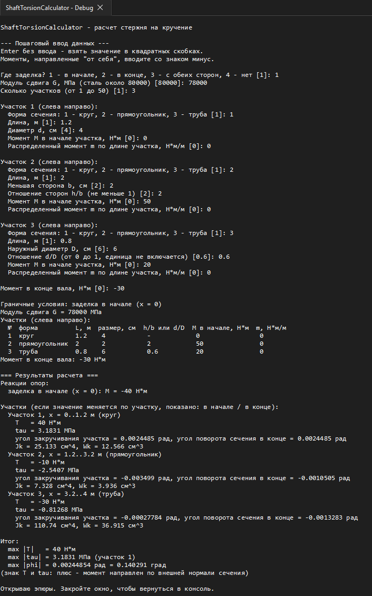
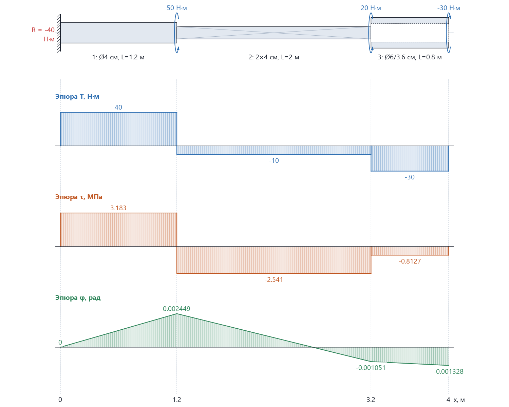
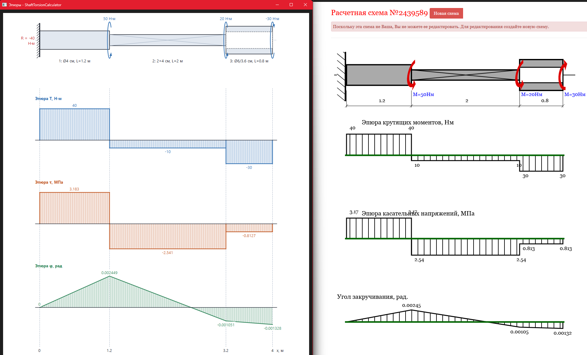

# ShaftTorsionCalculator

**Расчёт составного стержня на кручение на C++17 с построением эпюр средствами Qt / QPainter.**

Учебный проект по дисциплине «Основы цифрового дизайна». Программа определяет внутренние крутящие моменты, касательные напряжения, углы закручивания и реакции опор для стержня с несколькими участками.

## Возможности

- Консольный пошаговый ввод параметров и командное редактирование задачи.
- Сечения: **сплошной круг**, **прямоугольник**, **труба**.
- Сосредоточенные и равномерно распределённые крутящие моменты.
- Закрепления: слева, справа, с двух сторон; проверка равновесия без заделок.
- Расчёт `T(x)`, `τ(x)`, `φ(x)` и построение трёх эпюр.
- Визуализация через **Qt Widgets / QPainter**, экспорт в PNG.
- Загрузка задач из текстового файла и пакетный режим.
- Автоматические тесты вычислительного ядра.

## Скриншоты

### Справка по командам


### Ввод данных и результаты расчёта


### Расчётная схема и эпюры


### Сравнение с контрольным примером


Результаты проверены на [контрольной схеме №2439589](https://sopromat.xyz/projects/torsion?id=2439589). Для рассмотренного примера числовые значения и форма эпюр совпадают с эталонным расчётом.

## Технологии

`C++17` · `CMake ≥ 3.16` · `Qt 5/6 Widgets` · `QPainter` · `CTest`


В интерактивном режиме доступны `help`, `wizard`, `example`, `fixed`, `g`, `mend`, `add`, `edit`, `del`, `clear`, `show`, `calc`, `plot`, `png`, `quit`. Подробный синтаксис — через команду `help`.

**Единицы:** длина участков — м; размеры сечений — см; модуль сдвига `G` — МПа; сосредоточенный момент — Н·м; распределённый момент — Н·м/м.

## Структура проекта

```text
src/
  TorsionModel.h/.cpp       Модель и расчётное ядро
  ConsoleInterface.h/.cpp  Консольный интерфейс
  DiagramPainter.h/.cpp    Отрисовка посредством QPainter
  PlotterQt.cpp            Окно и экспорт PNG
  PlotterStub.cpp          Вариант сборки без Qt
  Plotter.h                Интерфейс визуализации
  main.cpp                 Точка входа
examples/                  Файлы с исходными данными
tests/test_solver.cpp      Автоматические тесты
CMakeLists.txt             Конфигурация сборки
docs/images/               Скриншоты
```


## Автор

**Ширинкин Егор Геннадьевич**  
ВГУ, ФКН
